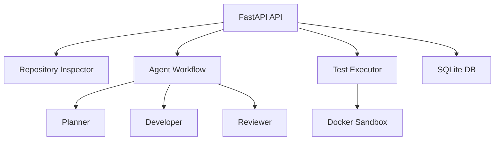

# DevPilot AI

AI-powered software engineering assistant that can inspect a Git repository, analyze a task, propose code changes, run tests in an isolated environment, and generate a report.

## Features

- **Repository Registration**: Register local repositories for analysis
- **Repository Inspection**: List files, identify Python modules and tests, summarize structure
- **Agent Workflow**: Planner → Developer → Reviewer → Test Executor
- **Diff Generation**: View proposed changes as Git diffs
- **Human Approval**: Explicit approval required before applying changes
- **Sandboxed Testing**: Docker-based isolated test execution (when available)
- **Task Reports**: Comprehensive reports with files, patches, tests, and results
- **Deterministic Mode**: Works without LLM API keys for demonstration

## Quick Start

### Installation

```bash
pip install -r requirements.txt
cp .env.example .env
```

### Run the Application

```bash
python main.py
# or
uvicorn app.api.main:app --reload
```

Access Swagger docs at http://localhost:8000/docs

### Using Docker

```bash
docker-compose up --build
```

## Usage Example

```bash
# Register a repository
curl -X POST http://localhost:8000/repositories \
  -H "Content-Type: application/json" \
  -d '{"path": "C:\\path\\to\\repo", "name": "myrepo"}'

# Inspect repository
curl http://localhost:8000/repositories/1/inspect

# Create a task
curl -X POST http://localhost:8000/tasks \
  -H "Content-Type: application/json" \
  -d '{"repo_id": 1, "description": "Add logging to main module"}'

# View diff
curl http://localhost:8000/tasks/1/diff

# Approve task
curl -X POST http://localhost:8000/tasks/1/approve

# Run tests
curl -X POST http://localhost:8000/tasks/1/test

# Get report
curl http://localhost:8000/tasks/1/report
```

## Architecture



## Security

- Path validation against approved directories
- No automatic push to remote
- Docker sandbox with resource limits
- No secrets exposed to LLM
- Explicit human approval required

## Limitations

- Deterministic mode uses simple heuristics
- Docker sandbox requires image setup
- Actual code application not automated (requires manual review/apply)
- Ollama integration optional

## Testing

```bash
pytest tests/
```
